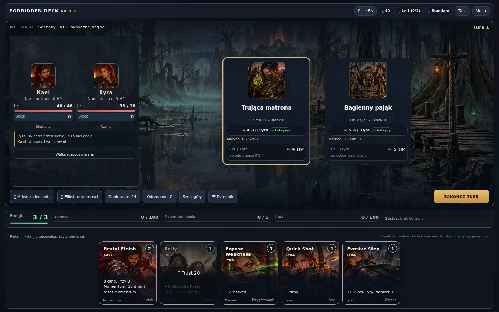
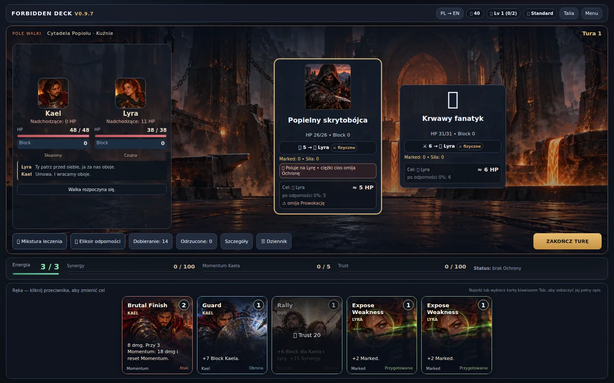
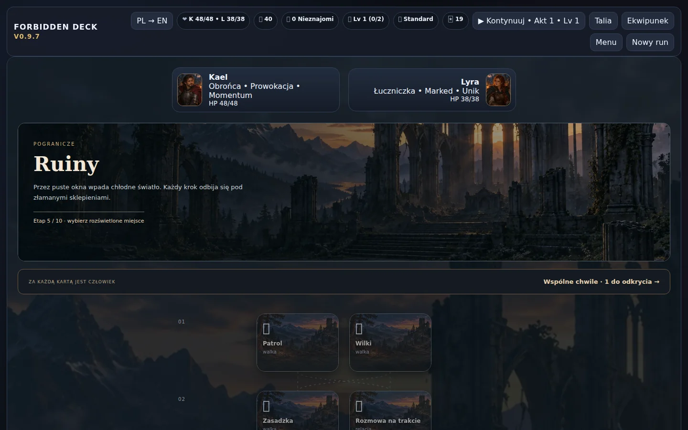

# V0.9.7 — Miejsca na szlaku

Wcześniej wszystkie walki aktu I pokazywały ten sam most, a ilustracja zajmowała jedynie mały panel bohaterów. Teraz panorama obejmuje arenę, a etykieta i teren wybranego węzła określają scenerię. Most i ruiny na tym samym etapie wyglądają inaczej. Kuźnia oraz schody tronu prowadzą do wnętrz zamiast pokazywać wyłącznie widok całej Cytadeli.

| Sceneria | Przykłady miejsc | Ilustracja |
| --- | --- | --- |
| Trakt | Patrol, Wilki, Przełęcz | Istniejące Pogranicze |
| Most | Most, Zawalony most | Istniejący most |
| Ruiny | Kultystki, Ruiny, Omszała brama, Spalona kaplica | Nowe opactwo |
| Las | Zarośla, Korzenie, Królowa Cierni | Istniejący Skażony Las |
| Bagno | Toksyczne bagno, Strażnik cierni | Nowe mokradła |
| Cytadela | Żarzące mury, Koszary fanatyków | Istniejąca Cytadela |
| Kuźnia | Kuźnie, Sala żaru | Nowa kuźnia |
| Tron | Schody tronu, Królowa Popiołu | Nowa sala tronowa |

Mapa pokazuje miniatury miejsc; mysz i Tab podmieniają dużą panoramę bez wyboru węzła i bez zmiany stanu runu. Domyślny podgląd przedstawia pierwszą dostępną drogę. Ogniska zachowują dotychczasowe regionalne ilustracje i czynności. Sklep korzysta ze scenerii regionu, a wydarzenie mostu zawsze z ilustracji mostu.

Dobór obrazu używa kanonicznych danych węzła, a PL/EN zmienia jedynie prezentację. Starszy zapis bez węzła dostaje scenerię krainy. Nie ma losowania tła podczas zagrywania kart, zmiany języka ani wczytania zapisu. Brakujący obraz nie blokuje akcji. Obrazy są lokalne i osadzane w samodzielnym HTML; nie wymagają serwera ani zewnętrznych usług podczas gry.

Ciemne powierzchnie HP, Block, statusów i intencji oddzielają informacje od panoramy. Warstwa obrazu nie przechwytuje kliknięć ani nie zajmuje miejsca w siatce ekranu. Nie dodano mechaniki terenu ani zmian balansu.

## Weryfikacja

Nowy test `location-scenes-smoke.mjs` przechodzi przez rzeczywiste węzły mapy do walki, porównuje podgląd i arenę, sprawdza brak mutacji runu przy podglądzie, wczytanie, PL/EN, starszy zapis, brak obrazu i rozmiary 1024×560, 1280×720, 1440×900, 1920×1080 i 390×844. Pozostałe testy regresji obejmują karty, walkę, bossów Standard, przejścia aktów, mapę, relacje, zapis i podgląd offline. Zrzuty ekranu pokazują faktycznie uruchomioną grę.

## Zrzuty

