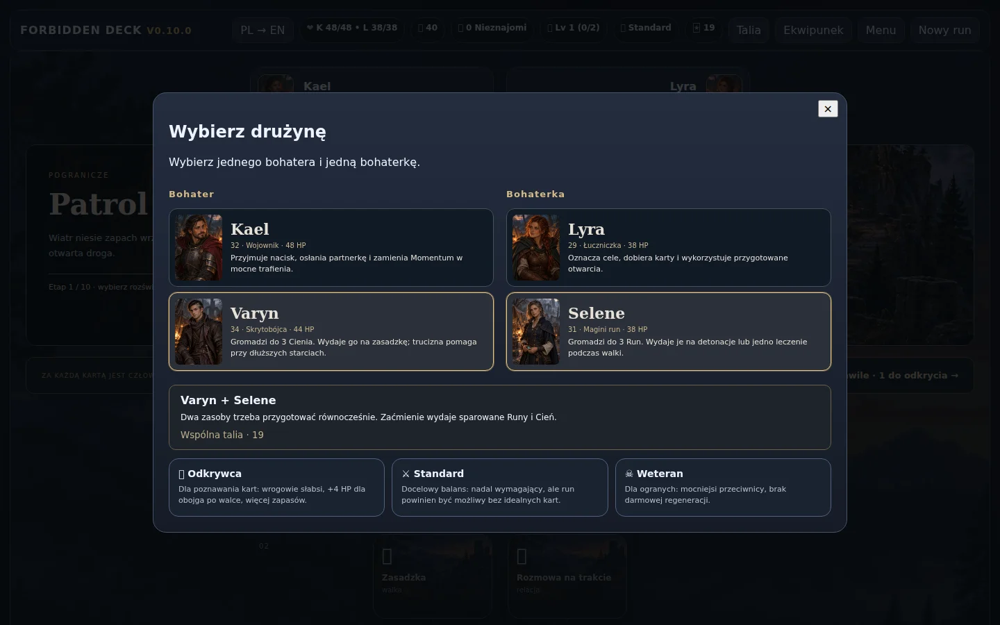
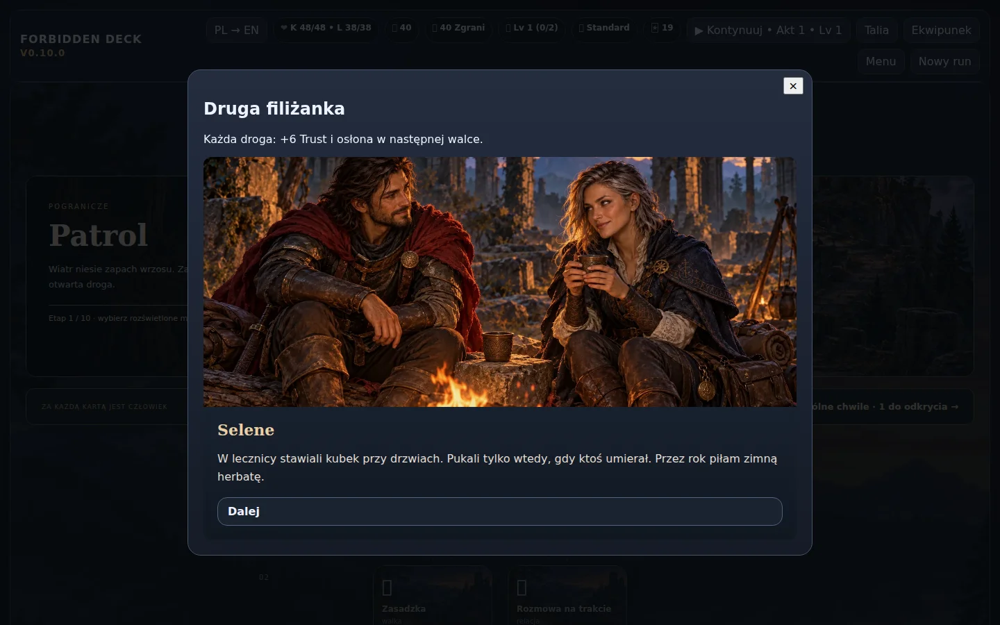

# V0.10.0 — Wybierz swój duet

Domknięcie etapów po fundamencie V0.9.8: wybór jednostek, cztery składy, mechaniki nowych bohaterów, dynamiczne widoki, niezależna pamięć relacji i ilustrowane rozmowy.

| Duet | Współpraca |
| --- | --- |
| Kael + Lyra | Dotychczasowa obrona, Marked i współpraca, z zachowanym postępem |
| Kael + Selene | Przechwytywanie ciosów w maginię, Runy wspierające odpowiedź egidy |
| Varyn + Lyra | Marked otwiera cel dla zasadzki i wspólnego polowania |
| Varyn + Selene | Równoczesne przygotowanie Cienia i Run do Zaćmienia |

Selene (31 lat) ma Runy i jedno leczenie na walkę. Varyn (34 lata) ma Cień, zasadzkę i truciznę. Dodano 18 kart bazowych z ulepszeniami, dwa atlasy 18 ilustracji działań, dwa portrety i trzy sceny obozowe. Łącznie gra zawiera 56 kart bazowych / 112 wariantów.

Nowe duety otrzymały 12 rozmów, reakcje w walce i albumy. Zaufanie, decyzje i wznawiane rozmowy są rozdzielone. Romans jest opcjonalny, wymaga osobnego wyboru i nie daje większych korzyści niż przyjaźń lub pominięcie. Sceny pozostają niegraficzne.

Każdy duet ukończył ustaloną trasę Aktu I na Standardzie, ze zwykłym rozwojem i oryginalnymi statystykami wrogów. Wyniki na wejściu do Aktu II: Kael–Lyra HP 16/38, Kael–Selene 50/43, Varyn–Lyra 30/36, Varyn–Selene 34/47. To jeden deterministyczny kontroler i seed, nie porównanie siły postaci przez graczy.

[Architektura i testy](PARTY_ARCHITECTURE.md) · [Prompty i pochodzenie ilustracji](../assets/roster-art-prompts.md)

## Pogłębienie dialogów po opinii graczy

Rozbudowano pięć wspomnień Kaela i Lyry oraz dwa dialogi ogniskowe. Dwanaście rozmów nowych duetów rozwija osobiste konflikty; wybory mają własne kwestie zamiast tych samych etykiet. Każda z dwunastu scen ma własne zakończenie przyjacielskie, a romantyczne zakończenia różnią się przy 40, 60 i 80 Trust. Flirt i wzajemny pociąg są wyrażone wprost, z pocałunkami i wygaszeniem sceny, bez graficznych treści seksualnych. Nie dodano trybu erotycznego ani nowej ilustracji nagości. Ustawienie wyraźnie opisuje zakres romansu.

Zachowano ID scen i wyborów, równe korzyści za romans/przyjaźń/pominięcie oraz domyślnie wyłączony romans. Dodano polskie i angielskie wersje nowych kwestii. Kontrolery dialogów obsługują teraz zmienną długość odpowiedzi i wznowienie na późniejszych kwestiach. Nie dodano nowych kar za wybór przyjaźni.

## Podgląd

## Weryfikacja końcowa

Przeszły testy wyboru czterech drużyn, zasobów i kart, przenoszenia pancerza, zapisów, krótkich ekranów, wszystkich par przez Akt I, pięciu wspomnień Kaela i Lyry, scen ogniskowych, polskich i angielskich tekstów oraz samodzielnego podglądu bez żądań sieciowych. Testy scen sprawdzają też powtórne oglądanie bez nagród i wyłączenie romansu w trakcie rozmowy. Dłuższe rozmowy wymagają zmiennej liczby kroków; testy nie zakładają już dwóch kwestii na odpowiedź.
